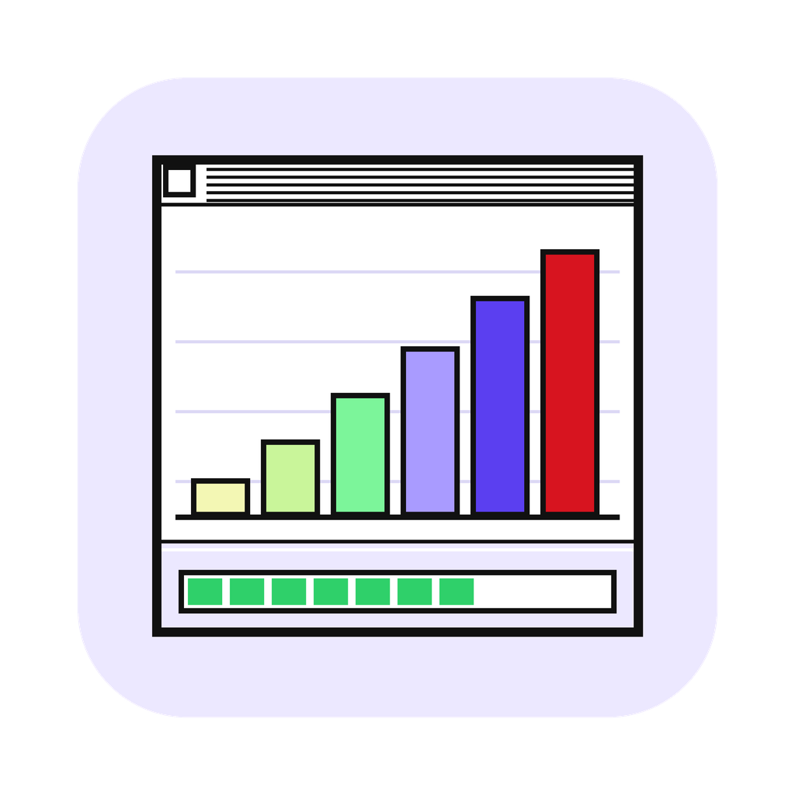
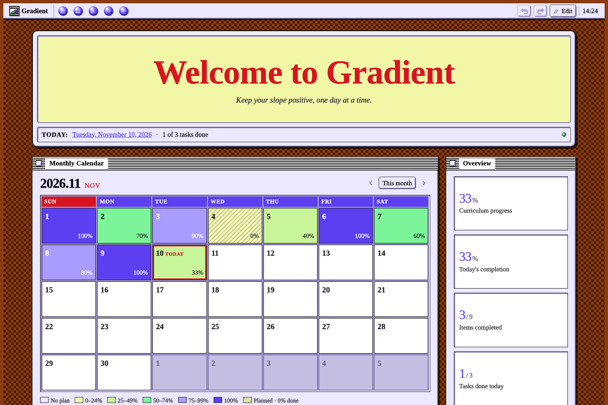
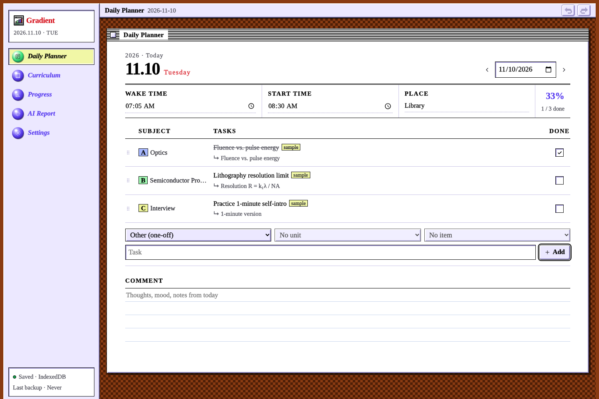
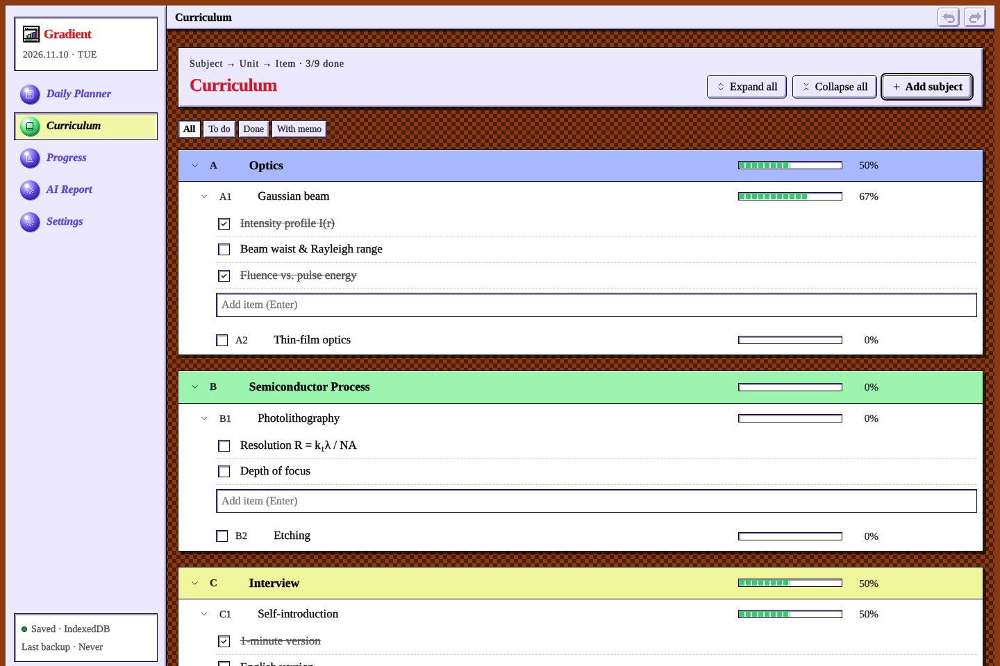
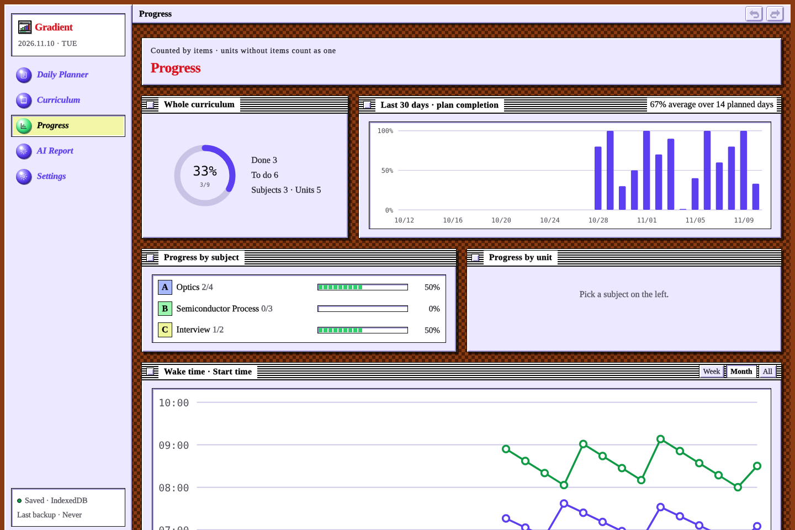
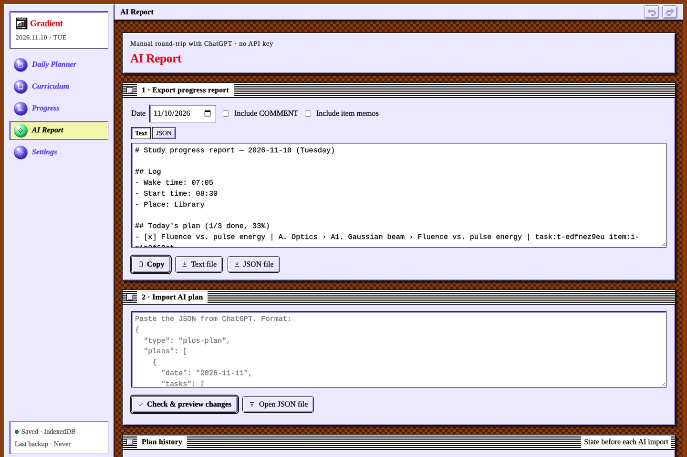

<p align="center">
  
</p>

<h1 align="center">Gradient</h1>
<p align="center"><i>Keep your slope positive, one day at a time.</i></p>

Gradient is a personal study planner with a 1996 Macintosh look. It ties a subject → unit → item curriculum to a daily paper-style planner, colors a monthly calendar by how much of each day's plan you finished, and lets you hand your progress to ChatGPT and bring a revised plan back.

It runs as a native macOS app or as a single HTML page in any browser. No account, no server, no API key.



## Features

- **Home**: a monthly calendar colored by daily completion (no plan, 0–24 %, … 100 %), with planned-but-0 % days hatched so they never look like empty days. Click a date to open that day's planner.
- **Daily Planner**: wake time, start time and place at the top, a SUBJECT / TASKS / DONE list, and a lined COMMENT area for a short diary. Pull yesterday's unfinished tasks in one click without duplicates.
- **Curriculum**: subjects → units → items with progress bars, optional per-item memos, filters (to do, done, with memo), and unit-level check-off for units that have no items.
- **Progress**: overall and per-subject progress, a 30-day completion chart and wake / start time trends.
- **AI Report**: export a day's progress as text or JSON (with stable IDs), paste ChatGPT's revised plan back, review every add / edit / move / delete, then apply. Every import can be reverted.
- **Editable layout**: drag, resize, hide and add widgets; add pages and menus; change icons, colors and sizes. Nothing is deleted for good: removed items go to a Trash you can restore from.
- **Safe storage**: autosave, daily snapshots, full JSON backup and restore, undo / redo.

| Planner | Curriculum |
|---|---|
|  |  |
| **Progress** | **AI Report** |
|  |  |

## Install (macOS)

### Download

1. Get `Gradient-macOS.zip` from [Releases](../../releases) and unzip it.
2. Move `Gradient.app` to `/Applications`.
3. The app is not notarized, so macOS blocks the first launch. Open **System Settings → Privacy & Security** and click **Open Anyway**, or run:
   ```bash
   xattr -dr com.apple.quarantine /Applications/Gradient.app
   ```

### Build from source

Only the Xcode Command Line Tools are needed (no Xcode).

```bash
xcode-select --install        # skip if already installed
git clone https://github.com/HongHyun-kr/Gradient.git
cd Gradient
./build.sh
cp -R build/Gradient.app /Applications/
```

## Use in a browser

Open `web/index.html` directly, or use the GitHub Pages version if it is enabled for this repository. In the browser, data is kept in that browser's IndexedDB only.

## Data

| | Location |
|---|---|
| macOS app | `~/Library/Application Support/Gradient/data.json`, plus daily copies in `backups/` (last 30 days) |
| Browser | IndexedDB of the browser you use |

Move data between the app and a browser with **Settings → Full backup (JSON)** and **Settings → Restore backup**.

## Using it with ChatGPT

1. **AI Report → Export progress report**, then copy the text. It ends with the JSON format ChatGPT should reply in.
2. Ask ChatGPT to revise the next day's plan in that format.
3. Paste the reply into **Import AI plan**, check the preview, and apply.

## Project layout

```
web/index.html        the whole app (HTML + CSS + JS, no dependencies)
Sources/main.swift    macOS wrapper (WKWebView, file storage, save/open panels)
Info.plist            app bundle metadata
icon/                 app icon source (1024 px)
build.sh              builds build/Gradient.app
.github/workflows/    release build on tags, GitHub Pages deploy
```

## Releasing

Push a version tag and GitHub Actions builds the app on macOS and attaches `Gradient-macOS.zip` to the release:

```bash
git tag v1.0.0
git push origin v1.0.0
```

## License

[MIT](LICENSE) © 2026 HongHyun-kr
